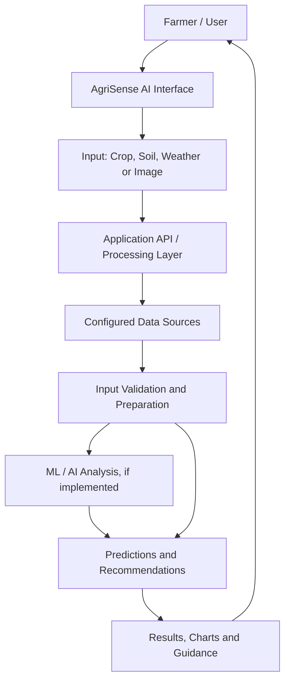

# AgriSense AI 🌾
### AI-Driven Agricultural Intelligence | Eco Sense AI

AgriSense AI is an agriculture-focused module within **Eco Sense AI**, designed to support data-informed farming and environmental decision-making. The module's documentation should reflect the crop, soil, weather, or plant-analysis capabilities that are actually implemented in this repository.

**Parent project:** [Eco Sense AI](https://github.com/Sunderganesh7/Eco-sense-AI)

---

## 📌 Overview

Agriculture is influenced by soil conditions, weather, crop selection, and plant health. AgriSense AI aims to bring relevant agricultural data and analysis into a clear workflow so users can better understand available information and make more informed decisions.

## ✨ Potential Capabilities

Depending on the features present in the current codebase, AgriSense AI may support:

- **Crop insights** — agricultural analysis based on the inputs supported by the application.
- **Soil information** — interpretation of soil-related data where implemented.
- **Plant health analysis** — image-based plant analysis if a trained model is included.
- **Weather-aware insights** — use of weather data if an API or dataset is configured.
- **Data visualization** — present agricultural results in a clear and accessible interface.

> Document only features that are implemented and tested. Remove any feature above that is not part of this repository.

## 🏗️ System Architecture

The diagram below shows a **proposed logical architecture** for an agricultural intelligence application. Confirm the components and connections against the actual source code before treating this as the deployed architecture.



### Architecture Layers

1. **Presentation layer** — provides the user interface and input forms.
2. **Input layer** — collects the information required by the selected feature.
3. **Application layer** — validates inputs and coordinates processing.
4. **Data layer** — accesses configured datasets, APIs, or stored records.
5. **Analysis layer** — runs the models or rules available in the project.
6. **Output layer** — returns results and displays them to the user.

## 🔄 Typical Workflow

1. Open the AgriSense AI module.
2. Select the available agricultural feature.
3. Enter the required information or upload a supported image.
4. Submit the input for processing.
5. Review the results generated by the configured model or analysis.
6. Use the results as decision support, considering local conditions and expert advice.

## 🧰 Technology Stack

The precise technology stack must be taken from this repository's dependency manifests, source files, and deployment configuration.

| Layer | Technology |
|---|---|
| Frontend | Confirm from the project files |
| Backend / API | Confirm from the project files |
| Machine learning | Confirm from model code and dependencies |
| Data sources | Confirm from configured datasets or APIs |
| Database | Include only if the application uses one |
| Deployment | Add the actual hosting platform and URL, if deployed |

## 📁 Project Structure

Use the actual directory structure from GitHub. The following is a generic reference only; remove entries that do not exist.

```text
Agrisense AI/
├── frontend/          # If a separate frontend exists
├── backend/           # If a backend exists
├── models/            # If trained models are included
├── data/              # If project data is included
├── tests/             # If tests are present
├── .env.example       # If environment variables are required
├── .gitignore
├── package.json       # If Node.js is used
├── requirements.txt   # If Python is used
└── README.md
```

## 🚀 Getting Started

### Prerequisites

Install the runtime and tools required by the actual repository, such as Node.js or Python.

### 1. Clone the parent repository

```bash
git clone https://github.com/Sunderganesh7/Eco-sense-AI.git
cd "Eco-sense-AI/Agrisense AI"
```

### 2. Install dependencies

Follow the dependency manifest present in the project.

**For a Node.js project with `package.json`:**

```bash
npm install
```

**For a Python project with `requirements.txt`:**

```bash
python -m venv .venv
```

Windows PowerShell:

```powershell
.venv\Scripts\Activate.ps1
pip install -r requirements.txt
```

macOS / Linux:

```bash
source .venv/bin/activate
pip install -r requirements.txt
```

If the application contains separate frontend and backend services, install the dependencies and follow the run instructions for each service independently.

### 3. Configure environment variables

If API keys or external service credentials are required:

1. Check `.env.example` and the source code for the expected variable names.
2. Set the values in a local `.env` file or in the deployment platform's environment settings.
3. Never commit real credentials to GitHub.

### 4. Run the application

Use the commands defined in the repository. For a Node.js application, check the `scripts` section of `package.json`. For a Python backend, check the project documentation and entry-point files. Do not assume that `npm start`, `npm run dev`, or a particular Python command exists unless it is defined by the project.

## 🔐 Security and Responsible Use

- Keep API keys, passwords, and access tokens out of source control.
- Add local `.env` files to `.gitignore`.
- Use placeholder values in `.env.example`.
- Rotate any credential that has been exposed in a public repository.
- Treat model output as decision support, not a guarantee of crop yield, disease diagnosis, or agricultural outcomes.
- Validate recommendations against local conditions and qualified agricultural guidance.

## ⚠️ Limitations

- Results depend on input quality, data coverage, model performance, and configured services.
- Agricultural conditions vary by location, season, crop variety, and farming practices.
- Predictions may be inaccurate and should not replace field assessment or professional advice.
- The capabilities available depend on the current codebase and its configuration.

## 🔮 Future Scope

Possible enhancements include:

- More detailed crop and soil analytics.
- Weather-based agricultural insights.
- Plant health image analysis with validated models.
- Historical reports and comparison charts.
- Downloadable recommendations and analysis summaries.
- Support for additional crops, regions, and languages.

## 🤝 Contributing

1. Create a branch for your change.
2. Make and test the change locally.
3. Document any new dependencies and environment variables.
4. Update the README when functionality or setup instructions change.
5. Submit a pull request with a clear description.

## 📄 License

Refer to the repository's `LICENSE` file if one exists. If the project does not yet have a license, select and add the appropriate license before describing it as open source.
