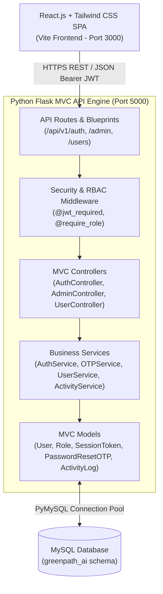
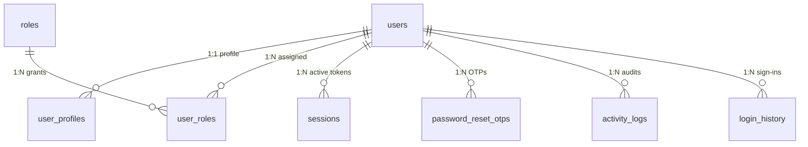
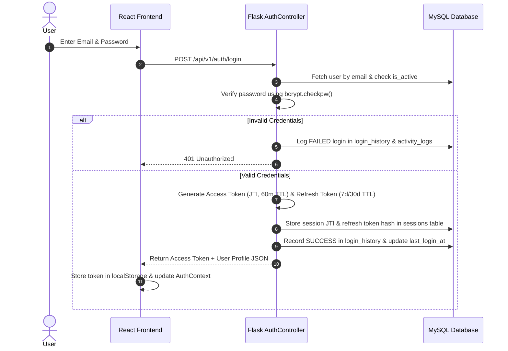

# GreenPath AI — Industry-Level Authentication & Security Module
### Final Year Major Project — Enterprise Security Architecture & Access Control

---

## 🌟 Executive Summary
**GreenPath AI** implements a complete, production-grade **Authentication, Authorization, and Security Module** built on an enterprise **Model-View-Controller (MVC)** architecture. Designed to meet industry security standards, this module provides seamless identity management, zero-trust token authentication, fine-grained Role-Based Access Control (RBAC), and exhaustive audit logging for AI detection workflows.



---

## 🏗️ 1. Architecture & Folder Structure

The project strictly follows the **Model-View-Controller (MVC)** pattern to enforce separation of concerns between data persistence, business rules, and HTTP presentation.

```
GreenPath AI/
├── greenpath_auth_backend/               # Flask MVC Backend (Python)
│   ├── config/
│   │   ├── __init__.py
│   │   └── settings.py                   # Environment configuration & MySQL variables
│   ├── database/
│   │   ├── __init__.py
│   │   ├── connection.py                 # PyMySQL thread-safe connection pool & session manager
│   │   └── schema.sql                    # Normalized MySQL DDL with FKs, indexes & seed data
│   ├── models/                           # MVC Model Layer (Active Record / Table Wrappers)
│   │   ├── __init__.py
│   │   ├── user.py                       # User & UserProfile models
│   │   ├── role.py                       # Role & UserRole junction models
│   │   ├── otp.py                        # PasswordResetOTP model with 5-minute expiry logic
│   │   ├── session_log.py                # SessionToken & LoginHistory models
│   │   └── activity.py                   # ActivityLog model with Admin search & filter support
│   ├── services/                         # Business Logic Layer
│   │   ├── __init__.py
│   │   ├── auth_service.py               # Registration, Login, Logout & Token Refresh workflows
│   │   ├── otp_service.py                # 6-digit OTP generation, email dispatch & verification
│   │   ├── user_service.py               # Profile editing, photo upload & password updates
│   │   ├── activity_service.py           # Enriched audit queries and filter options
│   │   └── email_service.py              # Email notification simulator / SMTP adapter
│   ├── controllers/                      # MVC Controller Layer (HTTP Request / JSON Response)
│   │   ├── __init__.py
│   │   ├── auth_controller.py            # Authentication REST API controller
│   │   ├── admin_controller.py           # Admin RBAC & audit logs controller
│   │   └── user_controller.py            # User profile & account controller
│   ├── routes/                           # Flask Blueprints Layer
│   │   ├── __init__.py
│   │   ├── auth_routes.py                # /api/v1/auth endpoints
│   │   ├── admin_routes.py               # /api/v1/admin endpoints
│   │   └── user_routes.py                # /api/v1/users endpoints
│   ├── middleware/                       # Request Interceptors & Route Guards
│   │   ├── __init__.py
│   │   ├── auth_middleware.py            # @jwt_required decorator with revocation checking
│   │   ├── rbac_middleware.py            # @require_role & @require_permission decorators
│   │   └── security_middleware.py        # CORS, HSTS, XSS & clickjacking headers setup
│   ├── authentication/                   # Cryptographic Engines
│   │   ├── __init__.py
│   │   ├── password_handler.py           # bcrypt password hashing (12 rounds) & verification
│   │   └── jwt_handler.py                # PyJWT Access & Refresh token generator/validator
│   ├── utils/                            # Shared Helper Utilities
│   │   ├── __init__.py
│   │   ├── validators.py                 # RFC 5322 Email regex, Strong Password & XSS sanitization
│   │   └── telemetry.py                  # Client IP, Browser, OS & Device parser
│   ├── uploads/profiles/                 # Secure local storage for uploaded profile avatars
│   ├── app.py                            # Application factory & WSGI server entry point
│   ├── requirements.txt                  # Python dependencies
│   └── .env.example                      # Environment variables template
│
└── greenpath_auth_frontend/              # React.js + Tailwind CSS SPA Frontend
    ├── src/
    │   ├── components/common/            # Reusable UI components & route guards
    │   │   ├── Navbar.jsx                # Glassmorphic top navigation with role badge & avatar
    │   │   ├── ProtectedRoute.jsx        # Auth session validation guard
    │   │   └── RoleRoute.jsx             # RBAC role verification guard (403 Access Denied screen)
    │   ├── context/
    │   │   └── AuthContext.jsx           # Global React Context for JWT & user profile state
    │   ├── pages/
    │   │   ├── auth/                     # Authentication screens
    │   │   │   ├── LoginPage.jsx         # Sign in with Remember Me & demo account switcher
    │   │   │   ├── RegisterPage.jsx      # Multi-column registration with live password meter
    │   │   │   ├── ForgotPasswordPage.jsx# 6-digit OTP email trigger
    │   │   │   ├── VerifyOtpPage.jsx     # OTP input with 5-minute countdown timer
    │   │   │   └── ResetPasswordPage.jsx # Secure password change with session revocation
    │   │   ├── profile/
    │   │   │   └── UserProfilePage.jsx   # Avatar upload, edit details & change password tabs
    │   │   └── admin/
    │   │       ├── AdminDashboardPage.jsx# Registered account directory & role selector
    │   │       ├── ActivityLogsPage.jsx  # System audit trail with search & action filter
    │   │       └── LoginHistoryPage.jsx  # Sign in/out telemetry with SUCCESS/FAILED status
    │   ├── services/
    │   │   └── api.js                    # REST API client with Bearer token interceptor
    │   ├── App.jsx                       # React Router SPA routes definition
    │   ├── main.jsx                      # DOM mount point
    │   └── index.css                     # Tailwind CSS tokens & glassmorphism utilities
    ├── index.html                        # Google Fonts (Outfit & Inter) inclusion
    ├── package.json
    ├── tailwind.config.js
    └── vite.config.js                    # API proxy configuration to port 5000
```

---

## 🗄️ 2. Normalized MySQL Database Design (`schema.sql`)

The database is normalized to **3NF (Third Normal Form)**, eliminating data redundancy and ensuring relational integrity through explicit Foreign Key constraints, cascading rules, and performance indexes.



### Table Definitions & Purpose
1. **`roles`**: Stores canonical RBAC roles (`Admin`, `Researcher`, `Officer`) and descriptions.
2. **`users`**: Stores central account credentials (`email`, `password_hash`, `is_active`, `created_at`, `updated_at`).
3. **`user_roles`**: Junction table mapping many-to-many relationships between users and roles (`user_id`, `role_id`, `assigned_at`).
4. **`user_profiles`**: Stored user metadata (`user_id`, `full_name`, `phone_number`, `profile_photo_url`, `designation`, `organization`, `last_login_at`).
5. **`sessions`**: Server-side JWT revocation registry (`id`, `user_id`, `jwt_id`, `refresh_token_hash`, `is_revoked`, `expires_at`, `created_at`).
6. **`password_reset_otps`**: Short-lived 6-digit OTP codes (`user_id`, `otp_hash`, `expires_at`, `is_used`, `created_at`).
7. **`activity_logs`**: Immutable security audit trail (`user_id`, `activity`, `details`, `ip_address`, `browser`, `device`, `timestamp`).
8. **`login_history`**: Login/Logout session telemetry (`user_id`, `login_time`, `logout_time`, `ip_address`, `browser`, `operating_system`, `device`, `status`).

---

## 🔐 3. Authentication & JWT Session Flow

The authentication flow utilizes **dual-token JSON Web Tokens (JWT)** combined with server-side revocation validation in MySQL to mitigate token theft while maintaining stateless scalability.



### Token Lifecycle Rules
- **Access Token (60-minute TTL)**: Short-lived Bearer token containing a unique UUID v4 `jti` (JWT ID), user ID (`sub`), email, and roles array.
- **Refresh Token (7-day / 30-day TTL)**: Longer-lived token tied to the session JTI. When `Remember Me` is selected during login, the refresh TTL is extended to 30 days.
- **Instant Revocation Check**: Every API request protected by `@jwt_required()` decodes the JWT and queries `sessions.is_revoked` in MySQL. If a user logs out, resets their password, or is deactivated by an Admin, the session JTI is revoked immediately (`is_revoked = 1`).

---

## 🛡️ 4. Role-Based Access Control (RBAC) Engine

GreenPath AI enforces strict permission hierarchies across both the frontend React UI and backend Flask APIs.

| Permission / Action | Admin (`id=1`) | Researcher (`id=2`) | Officer (`id=3`) |
| :--- | :---: | :---: | :---: |
| **Manage Users & Assign Roles** | ✅ Yes | ❌ No | ❌ No |
| **Deactivate / Delete Accounts** | ✅ Yes | ❌ No | ❌ No |
| **View System Audit Activity Logs** | ✅ Yes | ❌ No | ❌ No |
| **View All Users' Login History** | ✅ Yes | ❌ No | ❌ No |
| **Upload Plant Disease Images** | ✅ Yes | ✅ Yes | ❌ No |
| **Run AI Diagnosis / Detection** | ✅ Yes | ✅ Yes | ❌ No |
| **Generate Technical AI Reports** | ✅ Yes | ✅ Yes | ❌ No |
| **View & Download Saved Reports** | ✅ Yes | ✅ Yes | ✅ Yes |
| **Update Own Profile & Avatar** | ✅ Yes | ✅ Yes | ✅ Yes |

### Implementation in Flask (`rbac_middleware.py`)
- The `@require_role("Admin", "Researcher")` decorator inspects `g.current_user.roles`.
- If a user attempts to access an unauthorized endpoint, the middleware returns **HTTP 403 Forbidden** and automatically records an `Unauthorized Access Attempt` inside MySQL `activity_logs` containing the user's IP address and device telemetry.

---

## 🔒 5. Security Implementations & Hardening

1. **Password Hashing (bcrypt)**:
   - All passwords and OTP codes are hashed using `bcrypt` with a work factor of 12 rounds (`2^12` iterations).
   - Plaintext passwords are never stored in memory or databases.
   - Verification uses timing-attack-resistant comparison (`bcrypt.checkpw`).
2. **Password Complexity Meter**:
   - Enforced by `validate_password_strength()` on both server and client:
     - Minimum 8 characters
     - At least one uppercase letter (`A-Z`) and lowercase letter (`a-z`)
     - At least one digit (`0-9`)
     - At least one special symbol (`!@#$%^&*...`)
3. **Forgot Password 6-Digit Email OTP Flow**:
   - OTP codes are generated cryptographically (`random.randint`), hashed with bcrypt, and stored in MySQL `password_reset_otps` with an explicit 5-minute expiration timestamp.
   - Once used to reset a password, the OTP is flagged as used (`is_used = 1`) and all active sessions for that user are revoked across all devices.
4. **Input Sanitization & XSS Prevention**:
   - `sanitize_input()` cleanses user strings using HTML escaping (`html.escape`), neutralizing malicious scripts (`<script>`, `onerror=`, etc.).
5. **HTTP Security Headers (`security_middleware.py`)**:
   - **CORS**: Restricted to authorized frontend origins.
   - **X-Content-Type-Options**: `nosniff` (prevents MIME-sniffing).
   - **X-Frame-Options**: `DENY` (prevents clickjacking in iframe overlays).
   - **X-XSS-Protection**: `1; mode=block`.
   - **Strict-Transport-Security (HSTS)**: Active in production environments.

---

## 🚀 6. Quick Start & Setup Guide

### Step 1: Configure MySQL Database
Ensure your local MySQL server is running, then create the database:
```sql
CREATE DATABASE IF NOT EXISTS greenpath_ai;
```

### Step 2: Start Flask Backend (Port 5000)
```powershell
cd "c:\Users\Ganesh\OneDrive\Desktop\GreenPath AI\greenpath_auth_backend"
python -m venv venv
.\venv\Scripts\activate
pip install -r requirements.txt
python app.py
```
*Note: Upon startup, `app.py` automatically initializes all MySQL tables and seeds sample RBAC roles and demo accounts.*

### Step 3: Start React Frontend (Port 3000)
```powershell
cd "c:\Users\Ganesh\OneDrive\Desktop\GreenPath AI\greenpath_auth_frontend"
npm install
npm run dev
```

### 🧪 Default Demo Accounts (Pre-Seeded)
You can instantly test the three distinct RBAC roles using the built-in Quick Demo Accounts on the Login Page:
- **Admin**: `admin@greenpath.ai` | Password: `Admin@2025`
- **Researcher**: `researcher@greenpath.ai` | Password: `Research@2025`
- **Officer**: `officer@greenpath.ai` | Password: `Officer@2025`
