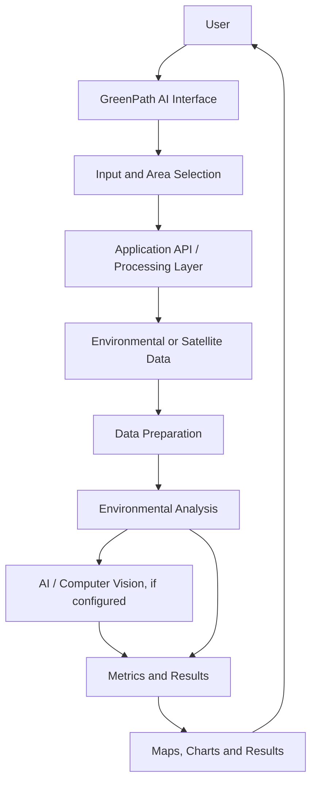

# GreenPath AI 🌿
### AI-Powered Environmental Intelligence | Eco Sense AI

GreenPath AI is an environmental intelligence module within **Eco Sense AI**. It is intended to help users explore environmental information and understand changes in green cover using the data, geospatial analysis, and AI capabilities implemented in the project.

**Parent repository:** [Eco Sense AI](https://github.com/Sunderganesh7/Eco-sense-AI)

---

## 🌍 Overview

Environmental monitoring can involve large amounts of geographic and satellite data. GreenPath AI aims to make environmental information easier to explore through a clear application workflow, visualizations, and data-driven analysis.

The exact functions and technologies should match the current source code in this repository.

## ✨ Project Goals

- **Environmental analysis:** Explore environmental information for a selected area.
- **Green-cover insights:** Present vegetation-related metrics when supported by available data.
- **Geospatial visualization:** Help users interpret results in geographic context.
- **AI-assisted analysis:** Use implemented AI or computer-vision components to support environmental assessment.
- **Monitoring over time:** Compare observations across dates when historical data is available.

## 🏗️ System Architecture

The following is a **conceptual architecture**. Confirm each component against the codebase before describing it as implemented.



### Architecture Components

1. **User Interface** — lets users interact with the features available in the application.
2. **Input and Area Selection** — collects the supported inputs, geographic area, or imagery.
3. **Data Access** — obtains or accepts environmental data according to the configured workflow.
4. **Data Preparation** — prepares input data for analysis.
5. **Analysis Layer** — performs the geospatial calculations or model inference implemented in the project.
6. **Results and Visualization** — presents the outputs through the available interface.

## 🔄 Typical Workflow

1. Open GreenPath AI.
2. Select the available analysis option and provide the required input.
3. Load or upload supported environmental data.
4. Run the analysis implemented by the application.
5. Review the resulting metrics and visualizations.
6. Compare observations over time if the application supports historical data.

## 🧰 Technology Stack

Update this table to reflect the actual dependency files and imports in `GreenPath AI/GreenPath AI`.

| Layer | Technology |
|---|---|
| Frontend | Confirm from the project files |
| Backend / API | Confirm from the project files |
| Data processing | Confirm from dependency manifests |
| AI / computer vision | Confirm from model and library imports |
| Geospatial data | Confirm from configured sources |
| Database | Add only if used by the application |
| Deployment | Add the actual hosting platform and URL, if deployed |

## 📁 Project Structure

The linked repository path contains a nested `GreenPath AI/GreenPath AI` directory. The tree below is a **template**, not a verified listing of your current files. Replace it with the actual directory names from GitHub.

```text
GreenPath AI/
└── GreenPath AI/
    ├── frontend/          # If a separate frontend exists
    ├── backend/           # If a separate backend exists
    ├── src/               # Application source code, if used
    ├── public/            # Static assets, if used
    ├── tests/             # Tests, if present
    ├── .env.example       # Example configuration, if present
    ├── .gitignore
    ├── requirements.txt   # If Python dependencies are used
    ├── package.json       # If Node.js dependencies are used
    └── README.md
```

Remove any entries that do not exist in the repository.

## 🚀 Getting Started

### Prerequisites

Install the runtime and tools required by the actual project. These may include Python, Node.js, or both.

### 1. Clone the repository

```bash
git clone https://github.com/Sunderganesh7/Eco-sense-AI.git
cd "Eco-sense-AI/GreenPath AI/GreenPath AI"
```

### 2. Install dependencies

Use the dependency manifest that actually exists.

**For a Node.js project with `package.json`:**

```bash
npm install
```

**For a Python project with `requirements.txt`:**

```bash
python -m venv .venv
```

Windows PowerShell:

```powershell
.venv\Scripts\Activate.ps1
pip install -r requirements.txt
```

macOS / Linux:

```bash
source .venv/bin/activate
pip install -r requirements.txt
```

If the project separates frontend and backend into different folders, install dependencies in each relevant folder.

### 3. Configure environment variables

If the application needs API keys or other settings:

1. Check the source code and `.env.example` for required variable names.
2. Add the values to a local `.env` file or your hosting provider's environment settings.
3. Keep real credentials out of source control.

### 4. Start the application

Use the run scripts defined in `package.json` or the documented backend entry point. For example, `npm run dev` is appropriate only if that script exists. Follow separate start instructions if the frontend and backend run independently.

## 🔐 Security

- Never commit API keys, passwords, access tokens, or private credentials.
- Keep `.env` files out of version control.
- Store production secrets in the hosting provider's secret settings.
- Keep `.env.example` values as placeholders.
- If a secret was pushed to a public repository, revoke or rotate it; deleting it from the latest commit may not remove it from Git history.

## ⚠️ Limitations

- Analysis quality depends on input data, its resolution, and its quality.
- Environmental changes may have seasonal or other causes that cannot be determined from a single image or metric.
- AI or computer-vision outputs may contain errors and should be validated.
- Features and results depend on the actual model, data sources, and configuration.

## 🔮 Future Scope

Potential enhancements include:

- Before-and-after environmental comparisons.
- Improved map-based exploration.
- Historical monitoring and time-series charts.
- Downloadable analysis reports.
- Model confidence and validation information.
- Integration with additional verified environmental datasets.

## 🤝 Contributing

1. Create a branch for your change.
2. Make and test your changes locally.
3. Document new dependencies and configuration.
4. Update the README when setup steps or features change.
5. Submit a pull request with a clear description.

## 📄 License

Refer to the repository's `LICENSE` file if one exists. If no license has been selected, choose and add the appropriate license before describing the project as open source.
